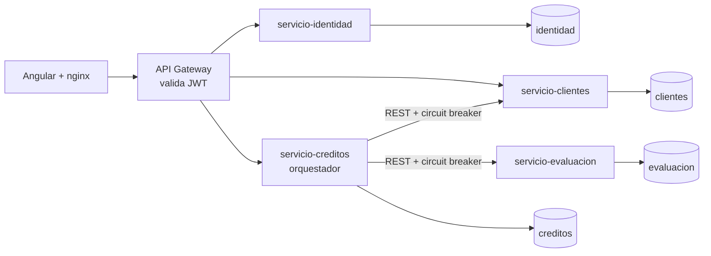
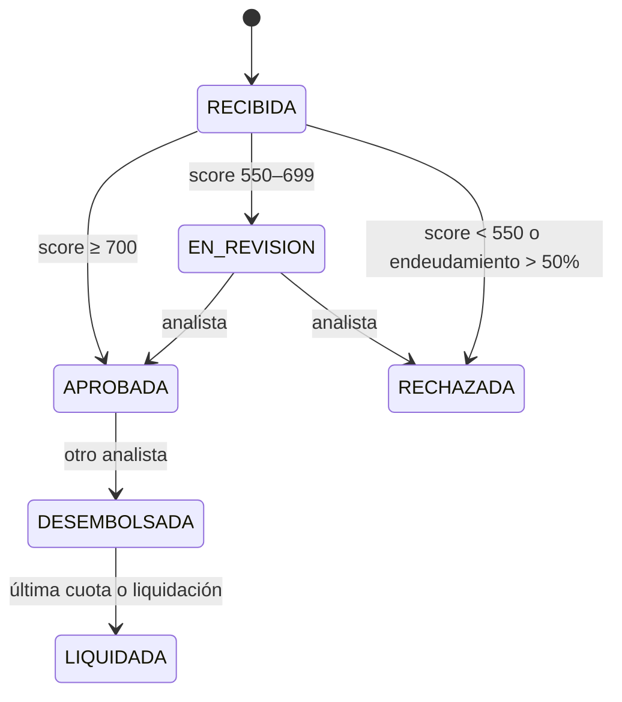

# Originación de Créditos

Plataforma de microservicios que recorre el ciclo de un crédito de consumo: solicitud, evaluación de riesgo, revisión por un analista, aprobación y desembolso con plan de pagos.

Es un proyecto de portafolio. Los datos son ficticios y los umbrales de riesgo son ilustrativos, no una política de crédito real.

**Stack:** Java 21 · Spring Boot 4 · Spring Cloud Gateway · Spring Security · JPA · Flyway · PostgreSQL · Resilience4j · Testcontainers · Angular 21 · Docker Compose · GitHub Actions

## Arquitectura



| Servicio | Puerto | Responsabilidad |
|---|---|---|
| `api-gateway` | 8080 | Único punto de entrada. Valida el JWT y traduce la identidad a cabeceras internas |
| `servicio-identidad` | interno | Login y emisión de JWT |
| `servicio-clientes` | interno | Datos financieros del cliente |
| `servicio-evaluacion` | interno | Motor de scoring, nunca expuesto al exterior |
| `servicio-creditos` | interno | Máquina de estados, plan de pagos y auditoría |
| `frontend` | 4200 | Dashboard, ofertas, créditos, movimientos y perfil, con vistas por rol |

## Flujo de una solicitud



## Interfaz

La disposición (nav superior, comparador a dos columnas y tarjeta de saldo) está inspirada en [Mortgage & Loan Dashboard](https://dribbble.com/shots/25041878-Mortgage-Loan-Dashboard), de Extej, adaptada a un tema oscuro propio.

## Decisiones de diseño

| Problema | Solución | Compromiso aceptado |
|---|---|---|
| Un doble clic o un reintento de red duplicaría la solicitud | Cabecera `Idempotency-Key` con restricción única en base de datos. La misma clave con otros datos responde 409 | El cliente debe generar y conservar la clave |
| Dos operaciones simultáneas sobre una solicitud | Bloqueo optimista con `@Version` | Un perdedor recibe 409 y debe reintentar |
| Importes con decimales | `BigDecimal` y `NUMERIC`, nunca `double`. La última cuota absorbe el redondeo para que el saldo termine en cero | La última cuota puede variar unos céntimos |
| Un servicio caído no debe perder solicitudes | La solicitud se guarda primero en `RECIBIDA`. Un circuit breaker corta el fallo y una tarea programada reintenta | Durante una caída el resultado no es inmediato |
| Transacciones entre servicios | Transacciones locales y operaciones idempotentes. No hay transacción distribuida ni llamadas HTTP dentro de una transacción | Consistencia eventual |
| Dos pagos simultáneos podrían cobrar la misma cuota | Bloqueo pesimista del crédito e `Idempotency-Key` por pago | Los pagos del mismo crédito se serializan |
| Decisiones automáticas opacas | Cada evaluación guarda los factores que explican el score | Más datos que conservar por solicitud |
| Trazabilidad regulatoria | Cada cambio de estado se audita en la misma transacción. Un trigger de PostgreSQL impide modificar o borrar la auditoría | La tabla solo crece |
| Fraude interno | Segregación de funciones: quien aprueba manualmente no puede desembolsar | Requiere al menos dos analistas |
| Suplantación por cabeceras | El gateway elimina `X-Usuario`, `X-Rol` y `X-Cliente-Id` entrantes antes de escribirlas desde el JWT | Los servicios confían en la red interna |
| Acoplamiento por datos | Una base de datos y un usuario por servicio, sin acceso cruzado | Una sola instancia de PostgreSQL por simplicidad en local |

## Puesta en marcha

Requiere Docker.

```bash
cp .env.example .env     # cambia los valores
docker compose up -d --build
```

Abre http://localhost:4200 y elige un perfil, o entra con la clave `DEMO_CLAVE` de tu `.env`. Para generar una cartera de ejemplo con seis meses de historia, ejecuta `./scripts/reiniciar-demo.sh`.

| Usuario | Rol | Resultado esperado con 10.000 a 36 meses |
|---|---|---|
| `ana` | Cliente | Aprobación automática |
| `luis` | Cliente | Revisión manual |
| `carla` | Cliente | Rechazo por endeudamiento |
| `maria`, `jorge` | Analista | Revisan y desembolsan |

## API

Todas las rutas pasan por `http://localhost:8080/api` y, salvo el login, requieren `Authorization: Bearer <token>`.

| Método | Ruta | Rol | Descripción |
|---|---|---|---|
| POST | `/auth/login` | Público | Obtiene el JWT |
| GET, PUT | `/auth/perfil` | Ambos | Consulta o actualiza el perfil propio |
| POST | `/auth/clave` | Ambos | Cambia la clave propia |
| GET | `/solicitudes/ofertas?monto=` | Ambos | Calcula la cuota por plazo |
| GET | `/solicitudes/resumen` | Ambos | Totales propios o de toda la cartera |
| GET | `/solicitudes/movimientos?limite=` | Ambos | Actividad reciente, también usada por las notificaciones |
| POST | `/solicitudes` | Cliente | Crea una solicitud. Requiere `Idempotency-Key` |
| GET | `/solicitudes?estado=&pagina=&tamano=` | Ambos | Lista propia o bandeja completa |
| GET | `/solicitudes/{id}` | Ambos | Detalle, plan y, para analistas, auditoría |
| POST | `/solicitudes/{id}/decision` | Analista | Aprueba o rechaza una solicitud en revisión |
| POST | `/solicitudes/{id}/desembolso` | Analista | Desembolsa un crédito aprobado |
| POST | `/solicitudes/{id}/pagos` | Cliente | Paga la siguiente cuota o liquida el crédito. Requiere `Idempotency-Key` |
| GET | `/solicitudes/analitica` | Analista | Embudo, aprobación, desembolsos por mes y mora |
| POST | `/auth/demo` | Público | Entrada sin clave, solo con el perfil `demo` |
| GET | `/clientes/{id}` | Ambos | Consulta un cliente |
| POST | `/clientes` | Analista | Registra un cliente |

Los errores siguen el formato `ProblemDetail` (RFC 9457).

## Pruebas

```bash
cd servicio-creditos && ./mvnw verify          # unitarias e integración con PostgreSQL real
DEMO_CLAVE='...' ./scripts/e2e.sh              # flujo completo contra el sistema levantado
```

El script E2E comprueba la seguridad, la idempotencia, la segregación de funciones y la recuperación al detener `servicio-evaluacion` a mitad del proceso.

## Próximos pasos

- Sustituir el reintento programado por eventos con Kafka y patrón Outbox.
- Validar el JWT también en cada servicio, firmarlo con RS256 o delegar en Keycloak.
- Añadir tracing distribuido con OpenTelemetry y paneles de Grafana.
- Limitar los intentos de login.
- Bloquear filas al recoger pendientes para ejecutar varias réplicas sin trabajo repetido.
